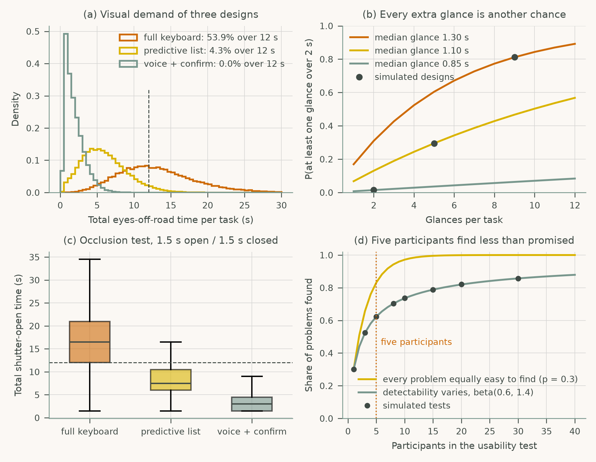
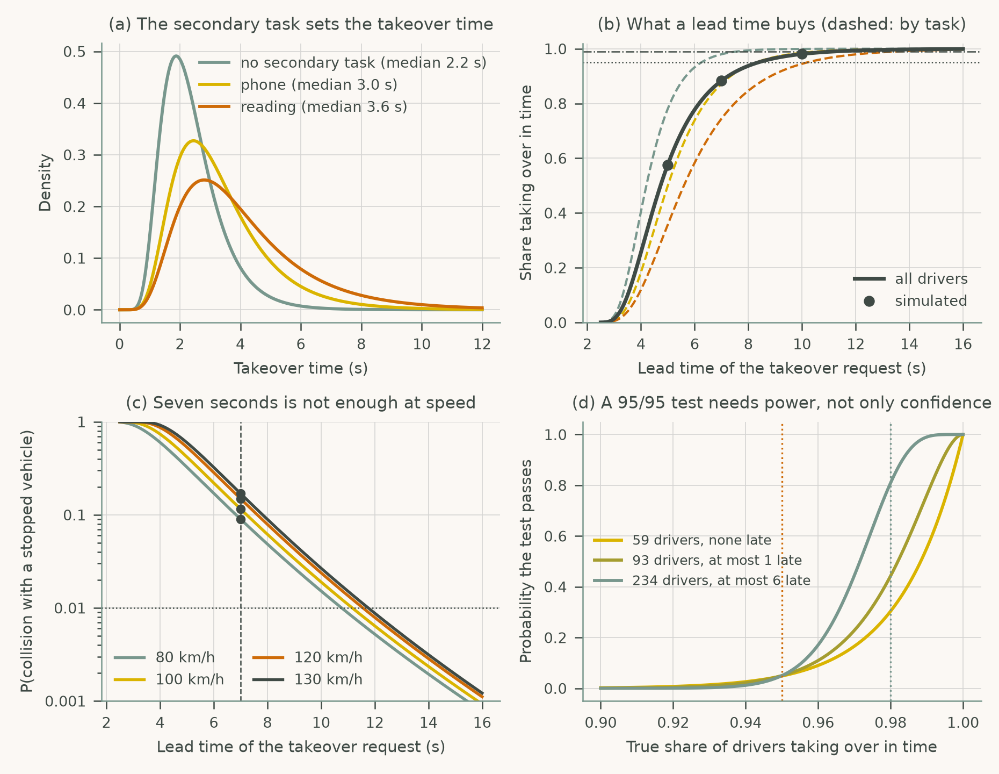
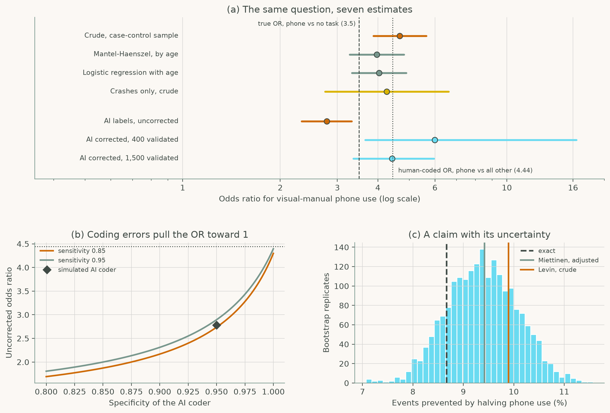

# Human-Computer Interaction in Roadway Safety

Companion code for **Human-Computer Interaction in Roadway Safety: Principles, Methods, and Applications** by Subasish Das.

**Website: <https://ai-in-transportation-lab.github.io/hci-in-rs/>**: browse every script with its figure and a download link.

Every code listing in the book's case studies is here as a runnable Python script, organised by chapter. The scripts generate their own synthetic data, so you can reproduce each figure and printed result with no data access agreements.

<p align="center">
  
  
  
</p>

## Contents

Chapter 1 has one worked example. Chapters 2 to 12 each have two case studies.

| Ch. | Title | Code |
|---|---|---|
| 1 | [Human Factors and Roadway Safety: Context and Challenges](chapters/ch01_human_factors_context/) | [WE1](chapters/ch01_human_factors_context/we1_glance_budget.py) The affordable glance |
| 2 | [Cognitive Foundations for Safe Driving Interaction](chapters/ch02_cognitive_foundations/) | [CS1](chapters/ch02_cognitive_foundations/cs1_workload_tlx_eye_tracking.py) Driver workload with NASA-TLX and eye tracking · [CS2](chapters/ch02_cognitive_foundations/cs2_trust_calibration.py) Trust calibration in decision support |
| 3 | [Distraction and Secondary Task Interaction](chapters/ch03_distraction/) | [CS1](chapters/ch03_distraction/cs1_infotainment_distraction.py) Infotainment distraction in urban driving · [CS2](chapters/ch03_distraction/cs2_warning_overload.py) Warning overload in safety-critical alerts |
| 4 | [In-Vehicle Interface Design for Safety-Critical Use](chapters/ch04_in_vehicle_interfaces/) | [CS1](chapters/ch04_in_vehicle_interfaces/cs1_glance_usability.py) Glance management and usability testing · [CS2](chapters/ch04_in_vehicle_interfaces/cs2_interaction_modalities.py) Touch, voice, gesture and multimodal interfaces |
| 5 | [Driver Assistance and Partial Automation (SAE Levels 1-3)](chapters/ch05_driver_assistance/) | [CS1](chapters/ch05_driver_assistance/cs1_driver_monitoring.py) Driver monitoring in Level 2 automation · [CS2](chapters/ch05_driver_assistance/cs2_takeover_timing.py) Takeover request timing for Level 3 |
| 6 | [Full Autonomy and Human-Machine Interaction (SAE Levels 4-5)](chapters/ch06_full_autonomy/) | [CS1](chapters/ch06_full_autonomy/cs1_ehmi_crossing.py) eHMI intent signaling for pedestrians · [CS2](chapters/ch06_full_autonomy/cs2_safety_assurance.py) Safety assurance for Level 4-5 deployment |
| 7 | [Human-AI Interaction in Safety-Critical Transportation Systems](chapters/ch07_human_ai_interaction/) | [CS1](chapters/ch07_human_ai_interaction/cs1_xai_dashboard.py) Explainable AI dashboards · [CS2](chapters/ch07_human_ai_interaction/cs2_bias_audit.py) Bias audit of a crash-risk model |
| 8 | [Vulnerable Road Users and Inclusive Interface Design](chapters/ch08_vulnerable_road_users/) | [CS1](chapters/ch08_vulnerable_road_users/cs1_v2p_alerts.py) V2P safety alerts · [CS2](chapters/ch08_vulnerable_road_users/cs2_inclusive_design.py) Inclusive interface design |
| 9 | [Roadside Interfaces, Connected Infrastructure, and ITS](chapters/ch09_roadside_its/) | [CS1](chapters/ch09_roadside_its/cs1_dms_work_zone.py) Dynamic message signs in work zones · [CS2](chapters/ch09_roadside_its/cs2_tmc_triage.py) AI-assisted TMC alert triage |
| 10 | [Evaluation Methods for Safety-Critical HCI](chapters/ch10_evaluation_methods/) | [CS1](chapters/ch10_evaluation_methods/cs1_simulator_field.py) Simulator and field evaluation · [CS2](chapters/ch10_evaluation_methods/cs2_nds_claims.py) Naturalistic driving evidence to safety claims |
| 11 | [Emerging Directions in HCI for Roadway Safety](chapters/ch11_emerging_directions/) | [CS1](chapters/ch11_emerging_directions/cs1_adaptive_copilot.py) Adaptive AI copilots · [CS2](chapters/ch11_emerging_directions/cs2_vr_training.py) AR/VR training environments |
| 12 | [Policy, Standards, and Implementation](chapters/ch12_policy_implementation/) | [CS1](chapters/ch12_policy_implementation/cs1_procurement.py) HCI evidence in procurement · [CS2](chapters/ch12_policy_implementation/cs2_implementation.py) Implementation framework for deployment |

Each chapter folder has its own README with the problem statement, libraries used and the figure the script reproduces.

## A taste of the code

The affordable glance (Chapter 1, Worked Example 1.1). The full scripts are on the [website](https://ai-in-transportation-lab.github.io/hci-in-rs/chapters/) and in [`chapters/`](chapters/).

```python
def affordable_glance(speed_kmh, sight_distance_m):
    """Longest off-road glance that still leaves room to stop."""
    v = speed_kmh / 3.6                 # m/s
    d_react = v * T_REACT               # road used while reacting
    d_brake = v ** 2 / (2 * A_BRAKE)    # road used while braking
    d_spare = sight_distance_m - d_react - d_brake
    return d_spare / v                  # negative: already too late
```

## Quick start

You need Python 3.10 or newer. [uv](https://docs.astral.sh/uv/) is the easiest way to get a matching environment:

```bash
git clone https://github.com/AI-in-Transportation-Lab/hci-in-rs.git
cd hci-in-rs
uv sync                                   # creates .venv and installs dependencies
uv run python scripts/run_all.py          # run every case study
```

Using pip instead:

```bash
python3 -m venv .venv && source .venv/bin/activate
pip install -r requirements.txt
python scripts/run_all.py
```

### Running a subset

```bash
python scripts/run_all.py --list              # show what would run
python scripts/run_all.py --chapter 6         # one chapter
python scripts/run_all.py -c 3 -k 2           # chapter 3, case study 2
make ch08                                     # same thing via make
```

The runner executes each script with `outputs/chNN/` as its working directory, so figures the listings write with relative paths land there and never in the source tree. You can also run a script directly (`python chapters/ch06_full_autonomy/cs1_ehmi_crossing.py`); output then goes to your current directory.

## Repository layout

```
hci-in-rs/
├── chapters/
│   ├── ch01_human_factors_context/         # one folder per chapter, each with a README
│   │   └── we1_glance_budget.py            # we<N>_<topic>.py = worked example N
│   ├── ch02_cognitive_foundations/
│   │   ├── cs1_workload_tlx_eye_tracking.py  # cs<N>_<topic>.py = case study N
│   │   └── cs2_trust_calibration.py
│   ├── ...
│   └── ch12_policy_implementation/
├── scripts/
│   └── run_all.py                          # run all / one chapter / one case study
├── index.md, getting-started.md, _config.yml  # Jekyll site (GitHub Pages)
├── docs/figures/                           # reference figures as printed in the book
├── outputs/                                # generated figures and files (git-ignored)
├── pyproject.toml  uv.lock  requirements.txt  Makefile
└── README.md
```

## Website

The site is built with Jekyll and the [just-the-docs](https://just-the-docs.com) theme. Each chapter page embeds the case-study scripts straight from `chapters/`, so the site cannot drift from the code. To publish: in the GitHub repo go to **Settings → Pages → Build and deployment**, choose **Deploy from a branch**, branch `main`, folder `/ (root)`. To preview locally:

```bash
bundle install
bundle exec jekyll serve      # http://localhost:4000/hci-in-rs/
```

## Reproducibility notes

- All data are synthetic and generated with fixed seeds. Numbers can still differ slightly across library versions and platforms. `uv.lock` pins the versions used to check these scripts.
- The synthetic data illustrate methods. They are not agency or manufacturer data, and results should not be read as findings about real drivers, vehicles, or roadways.
- The scripts are the book's listings verbatim; only a short docstring header was added to each. If a listing in the book is updated, regenerate or edit the matching script.

## License

The code in this repository is released under the [MIT License](LICENSE). The book text itself is not covered by this license.
