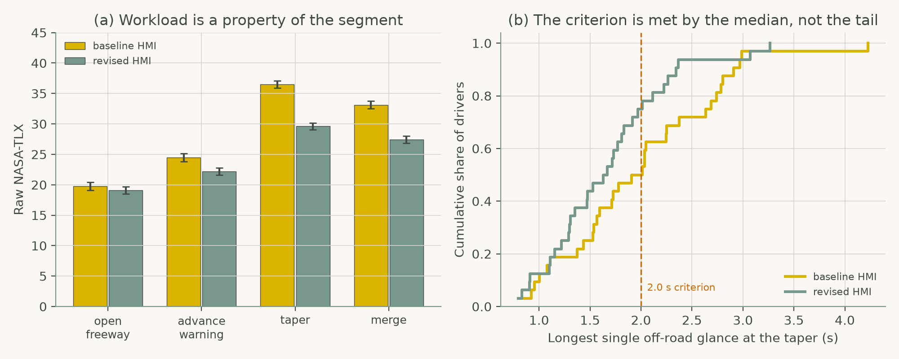
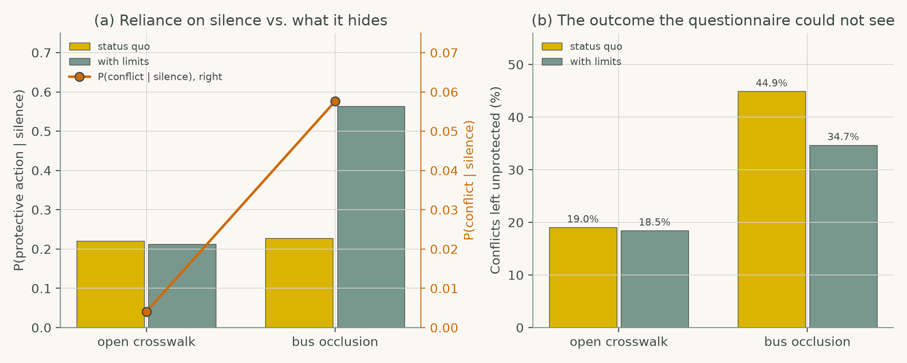

# Chapter 2: Cognitive Foundations for Safe Driving Interaction

Companion code for Chapter 2 of *Human-Computer Interaction in Roadway Safety*. Each script is the concatenation, in book order, of that case study's listings in the chapter, so it runs top to bottom without edits.

| Script | Case study | Libraries |
|---|---|---|
| [`cs1_workload_tlx_eye_tracking.py`](cs1_workload_tlx_eye_tracking.py) | Case Study 1: Measuring Driver Workload Using NASA-TLX and Eye Tracking | NumPy, pandas, SciPy, matplotlib |
| [`cs2_trust_calibration.py`](cs2_trust_calibration.py) | Case Study 2: Trust Calibration in Automated Driving Decision Support | NumPy, pandas, matplotlib |

## Case Study 1: Measuring Driver Workload Using NASA-TLX and Eye Tracking

Simulate a within-subject work-zone simulator study, compare a revised HMI with the baseline segment by segment, and test the longest off-road glance at the taper against the 2.0 s criterion.



## Case Study 2: Trust Calibration in Automated Driving Decision Support

Model reliance on a pedestrian-conflict alert that stays silent behind a stopped bus, and show which outcome measure reveals what an interface change actually does.



## Run

```bash
python scripts/run_all.py --chapter 2      # from the repository root
```

Outputs (figures, printed results) are written to `outputs/ch02/`.
