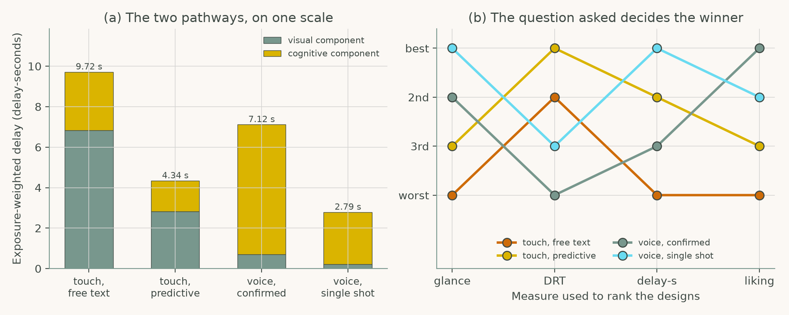
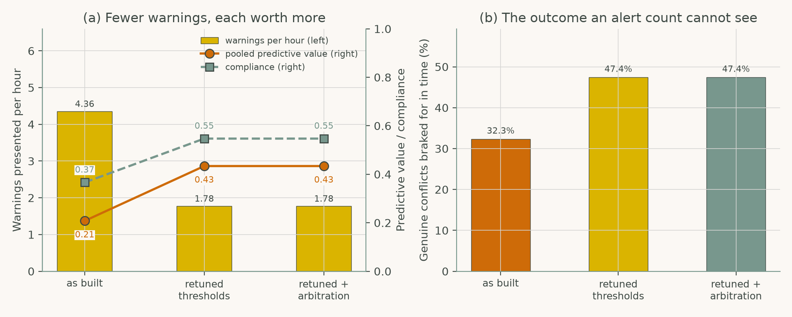

# Chapter 3: Distraction and Secondary Task Interaction

Companion code for Chapter 3 of *Human-Computer Interaction in Roadway Safety*. Each script is the concatenation, in book order, of that case study's listings in the chapter, so it runs top to bottom without edits.

| Script | Case study | Libraries |
|---|---|---|
| [`cs1_infotainment_distraction.py`](cs1_infotainment_distraction.py) | Case Study 1: Smartphone and Infotainment Distraction in Urban Driving | NumPy, pandas, SciPy, matplotlib |
| [`cs2_warning_overload.py`](cs2_warning_overload.py) | Case Study 2: Warning Overload and Attention Capture in Safety-Critical Alerts | NumPy, pandas, matplotlib |

## Case Study 1: Smartphone and Infotainment Distraction in Urban Driving

Compare four destination-entry designs on glances, detection-response cost, exposure-weighted delay and driver preference, and show that the winner depends on the measure.



## Case Study 2: Warning Overload and Attention Capture in Safety-Critical Alerts

Compare an as-built warning suite with retuned thresholds and with arbitration by warnings per hour, predictive value, compliance and conflicts braked for in time.



## Run

```bash
python scripts/run_all.py --chapter 3      # from the repository root
```

Outputs (figures, printed results) are written to `outputs/ch03/`.
