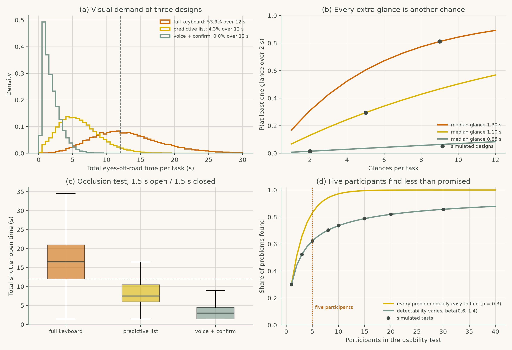
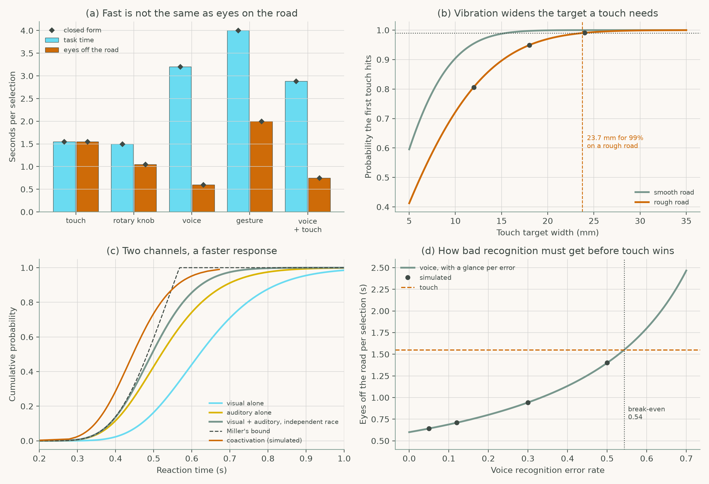

# Chapter 4: In-Vehicle Interface Design for Safety-Critical Use

Companion code for Chapter 4 of *Human-Computer Interaction in Roadway Safety*. Each script is the concatenation, in book order, of that case study's listings in the chapter, so it runs top to bottom without edits.

| Script | Case study | Libraries |
|---|---|---|
| [`cs1_glance_usability.py`](cs1_glance_usability.py) | Case Study 1: Glance Management and Usability Testing for In-Vehicle HMIs | NumPy, pandas, SciPy, matplotlib |
| [`cs2_interaction_modalities.py`](cs2_interaction_modalities.py) | Case Study 2: Comparing Touch, Voice, Gesture, and Multimodal Interfaces for Driver Safety | NumPy, pandas, SciPy, matplotlib |

## Case Study 1: Glance Management and Usability Testing for In-Vehicle HMIs

Simulate glances for three destination-entry designs, check them against the NHTSA criteria and an occlusion test, and estimate how many participants a usability test needs.



## Case Study 2: Comparing Touch, Voice, Gesture, and Multimodal Interfaces for Driver Safety

Compare five selection modalities by task time and eyes-off-road time, size touch targets for road vibration, model redundant signals, and find the voice error rate at which touch wins.



## Run

```bash
python scripts/run_all.py --chapter 4      # from the repository root
```

Outputs (figures, printed results) are written to `outputs/ch04/`.
