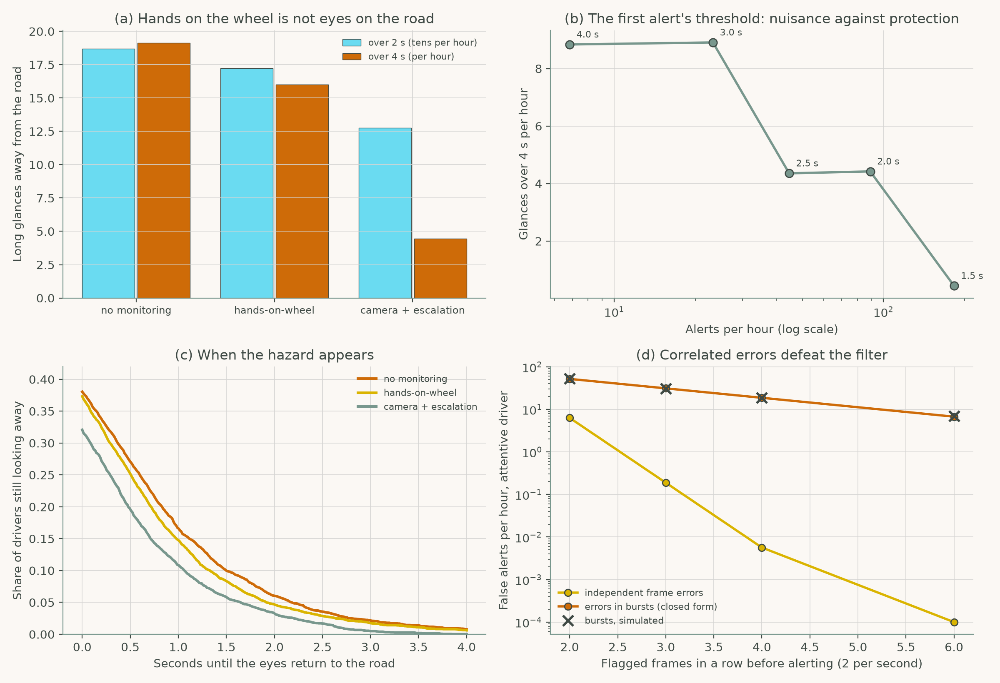
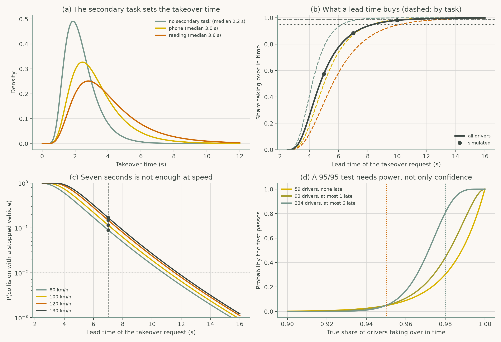

# Chapter 5: Driver Assistance and Partial Automation (SAE Levels 1-3)

Companion code for Chapter 5 of *Human-Computer Interaction in Roadway Safety*. Each script is the concatenation, in book order, of that case study's listings in the chapter, so it runs top to bottom without edits.

| Script | Case study | Libraries |
|---|---|---|
| [`cs1_driver_monitoring.py`](cs1_driver_monitoring.py) | Case Study 1: Driver Monitoring and Engagement in SAE Level 2 Automation | NumPy, pandas, SciPy, matplotlib |
| [`cs2_takeover_timing.py`](cs2_takeover_timing.py) | Case Study 2: Takeover Request Timing and Transition Design for SAE Level 3 Systems | NumPy, pandas, SciPy, matplotlib |

## Case Study 1: Driver Monitoring and Engagement in SAE Level 2 Automation

Compare no monitoring, hands-on-wheel checks and camera monitoring with escalation by long glances away, tune the first alert, and show how correlated errors defeat a frame filter.



## Case Study 2: Takeover Request Timing and Transition Design for SAE Level 3 Systems

Model takeover times by secondary task, find the lead time a takeover request needs, the collision risk at speed, and the sample size of a 95/95 validation test.



## Run

```bash
python scripts/run_all.py --chapter 5      # from the repository root
```

Outputs (figures, printed results) are written to `outputs/ch05/`.
