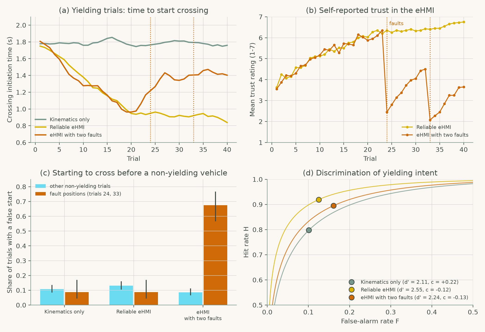
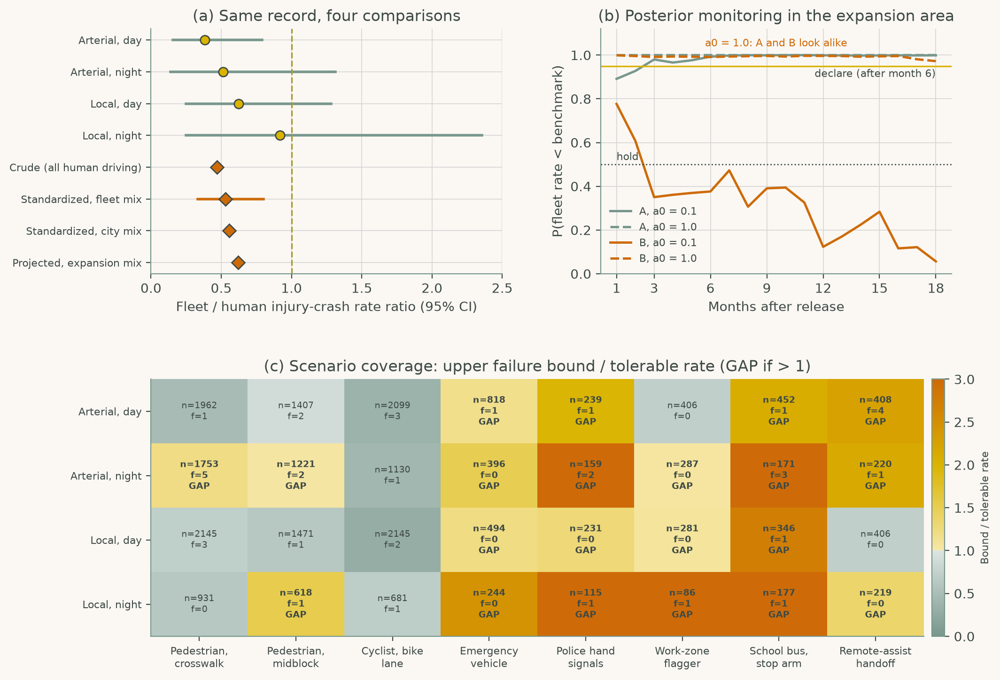

# Chapter 6: Full Autonomy and Human-Machine Interaction (SAE Levels 4-5)

Companion code for Chapter 6 of *Human-Computer Interaction in Roadway Safety*. Each script is the concatenation, in book order, of that case study's listings in the chapter, so it runs top to bottom without edits.

| Script | Case study | Libraries |
|---|---|---|
| [`cs1_ehmi_crossing.py`](cs1_ehmi_crossing.py) | Case Study 1: eHMI Intent Signaling for Pedestrian Interaction with Autonomous Vehicles | NumPy, pandas, SciPy, statsmodels, matplotlib |
| [`cs2_safety_assurance.py`](cs2_safety_assurance.py) | Case Study 2: Safety Assurance and Standardization for SAE Level 4-5 Deployment | NumPy, pandas, SciPy, matplotlib |

## Case Study 1: eHMI Intent Signaling for Pedestrian Interaction with Autonomous Vehicles

Simulate a VR crossing experiment with kinematics only, a reliable eHMI and an eHMI with two faults, and track crossing times, trust, false starts and discrimination of yielding intent.



## Case Study 2: Safety Assurance and Standardization for SAE Level 4-5 Deployment

Compare a robotaxi fleet's injury-crash rate with human benchmarks four ways, monitor it with a Bayesian posterior in an expansion area, and check scenario coverage against tolerable failure rates.



## Run

```bash
python scripts/run_all.py --chapter 6      # from the repository root
```

Outputs (figures, printed results) are written to `outputs/ch06/`.
