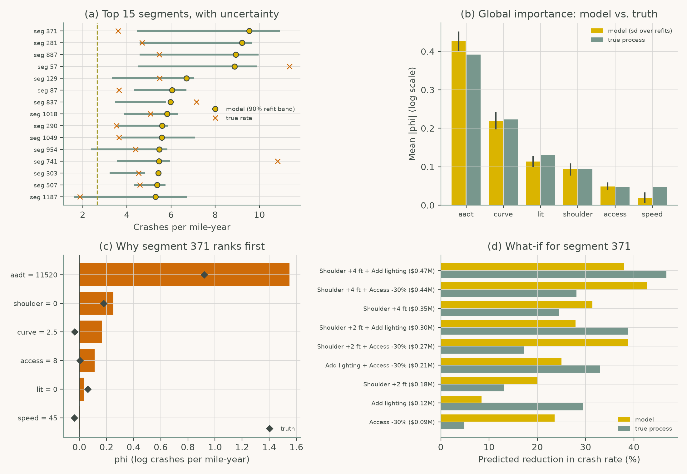
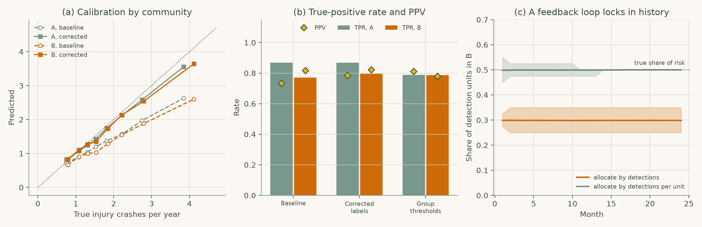

# Chapter 7: Human-AI Interaction in Safety-Critical Transportation Systems

Companion code for Chapter 7 of *Human-Computer Interaction in Roadway Safety*. Each script is the concatenation, in book order, of that case study's listings in the chapter, so it runs top to bottom without edits.

| Script | Case study | Libraries |
|---|---|---|
| [`cs1_xai_dashboard.py`](cs1_xai_dashboard.py) | Case Study 1: Explainable AI Dashboards for Transportation Safety Decision Support | NumPy, pandas, SciPy, scikit-learn, matplotlib |
| [`cs2_bias_audit.py`](cs2_bias_audit.py) | Case Study 2: Bias, Accountability, and Transparency in AI-Enabled Road Safety Systems | NumPy, pandas, SciPy, scikit-learn, matplotlib |

## Case Study 1: Explainable AI Dashboards for Transportation Safety Decision Support

Rank 1,200 rural segments with a crash-rate model, show uncertainty, global and local attributions and what-if options, and compare each view with the true process.



## Case Study 2: Bias, Accountability, and Transparency in AI-Enabled Road Safety Systems

Audit a crash-risk model trained on under-reported police data for calibration and equal opportunity across two communities, and simulate the feedback loop of allocating by detections.



## Run

```bash
python scripts/run_all.py --chapter 7      # from the repository root
```

Outputs (figures, printed results) are written to `outputs/ch07/`.
