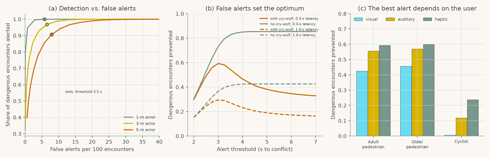
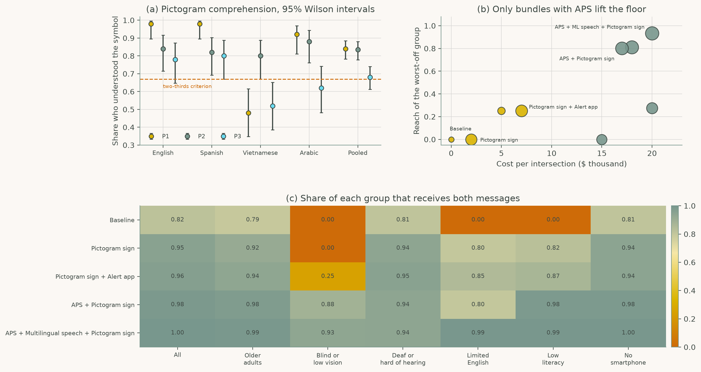

# Chapter 8: Vulnerable Road Users and Inclusive Interface Design

Companion code for Chapter 8 of *Human-Computer Interaction in Roadway Safety*. Each script is the concatenation, in book order, of that case study's listings in the chapter, so it runs top to bottom without edits.

| Script | Case study | Libraries |
|---|---|---|
| [`cs1_v2p_alerts.py`](cs1_v2p_alerts.py) | Case Study 1: V2P Safety Alerts for Pedestrians and Cyclists | NumPy, pandas, matplotlib |
| [`cs2_inclusive_design.py`](cs2_inclusive_design.py) | Case Study 2: Inclusive Interface Design for Accessibility, Language, and Equity | NumPy, pandas, matplotlib |

## Case Study 1: V2P Safety Alerts for Pedestrians and Cyclists

Choose a V2P alert threshold, show how protection depends on positioning error, latency and false alerts, and compare visual, auditory and haptic alerts by user group.



## Case Study 2: Inclusive Interface Design for Accessibility, Language, and Equity

Test pictogram comprehension with Wilson intervals, compute the reach of each message bundle for every user group, and find the bundles that lift the worst-off group.



## Run

```bash
python scripts/run_all.py --chapter 8      # from the repository root
```

Outputs (figures, printed results) are written to `outputs/ch08/`.
