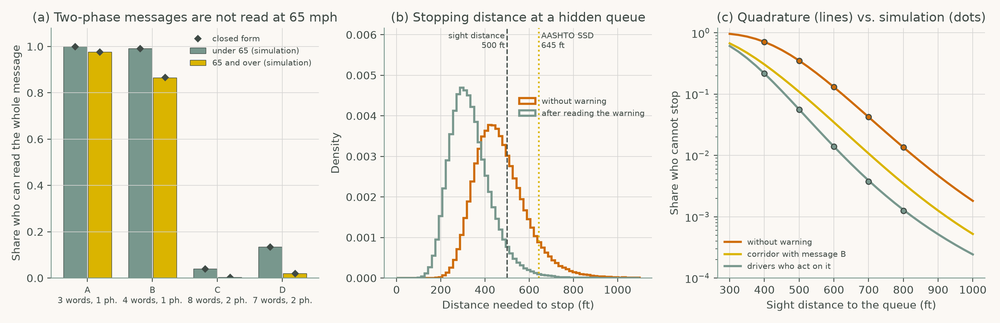
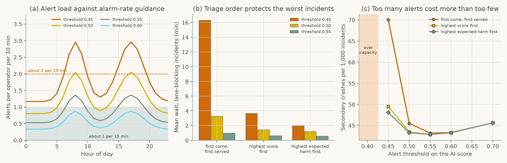

# Chapter 9: Roadside Interfaces, Connected Infrastructure, and ITS

Companion code for Chapter 9 of *Human-Computer Interaction in Roadway Safety*. Each script is the concatenation, in book order, of that case study's listings in the chapter, so it runs top to bottom without edits.

| Script | Case study | Libraries |
|---|---|---|
| [`cs1_dms_work_zone.py`](cs1_dms_work_zone.py) | Case Study 1: Dynamic Message Signs and Work Zone Messaging for Driver Comprehension | NumPy, pandas, SciPy, matplotlib |
| [`cs2_tmc_triage.py`](cs2_tmc_triage.py) | Case Study 2: AI-Assisted Traffic Management Center Visualization for Safety Decisions | NumPy, pandas, SciPy, matplotlib |

## Case Study 1: Dynamic Message Signs and Work Zone Messaging for Driver Comprehension

Check which of four message-sign texts drivers can read at speed, and estimate how a queue warning changes stopping distance and the share of drivers who cannot stop.



## Case Study 2: AI-Assisted Traffic Management Center Visualization for Safety Decisions

Simulate AI video alerts verified by two TMC operators, compare alert thresholds and triage orders, and find the setting that minimizes secondary crashes.



## Run

```bash
python scripts/run_all.py --chapter 9      # from the repository root
```

Outputs (figures, printed results) are written to `outputs/ch09/`.
