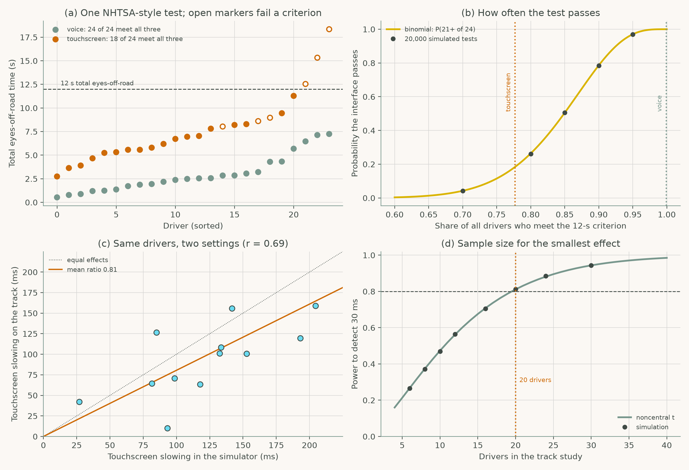
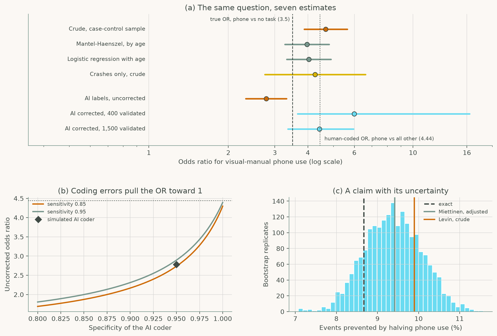

# Chapter 10: Evaluation Methods for Safety-Critical HCI

Companion code for Chapter 10 of *Human-Computer Interaction in Roadway Safety*. Each script is the concatenation, in book order, of that case study's listings in the chapter, so it runs top to bottom without edits.

| Script | Case study | Libraries |
|---|---|---|
| [`cs1_simulator_field.py`](cs1_simulator_field.py) | Case Study 1: Simulator and Field Evaluation of Distraction, Workload, and Trust | NumPy, pandas, SciPy, statsmodels, matplotlib |
| [`cs2_nds_claims.py`](cs2_nds_claims.py) | Case Study 2: Translating Naturalistic Driving Evidence into Safety Claims | NumPy, pandas, SciPy, scikit-learn, statsmodels, matplotlib |

## Case Study 1: Simulator and Field Evaluation of Distraction, Workload, and Trust

Run NHTSA-style glance tests on touchscreen and voice entry, compute how often such a test passes, relate simulator and track effects, and size a track study.



## Case Study 2: Translating Naturalistic Driving Evidence into Safety Claims

Estimate the odds ratio for visual-manual phone use seven ways, correct AI-coded labels for misclassification, and bootstrap the share of events prevented by halving phone use.



## Run

```bash
python scripts/run_all.py --chapter 10      # from the repository root
```

Outputs (figures, printed results) are written to `outputs/ch10/`.
