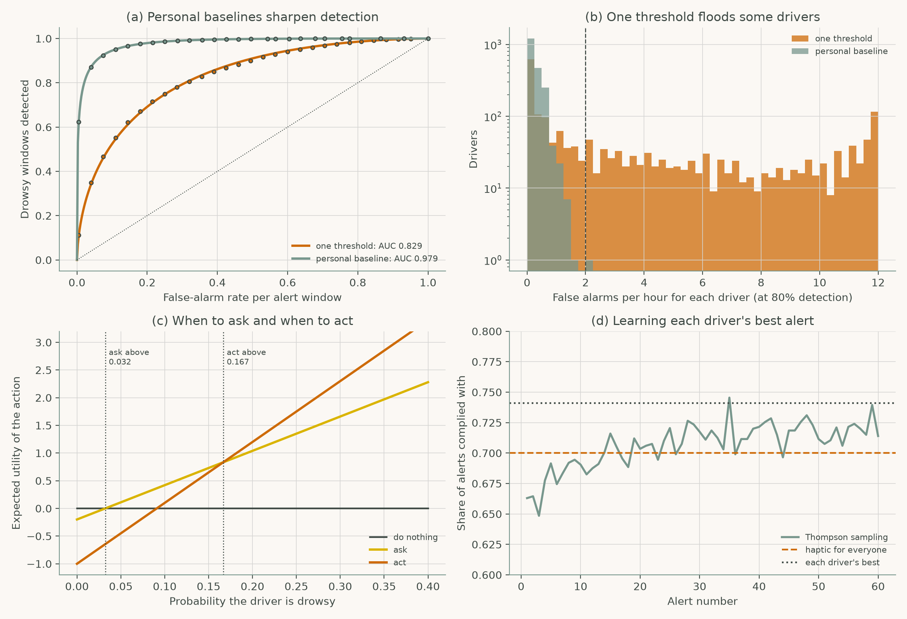
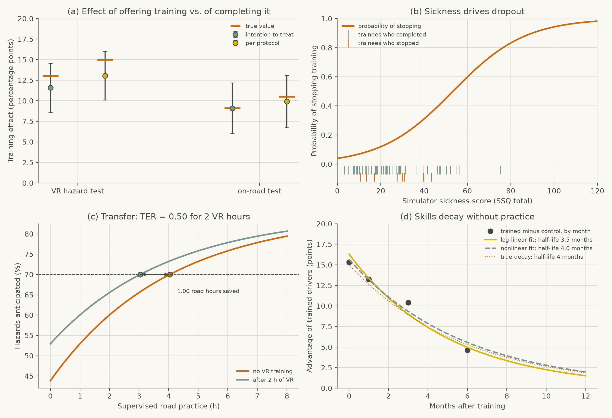

# Chapter 11: Emerging Directions in HCI for Roadway Safety

Companion code for Chapter 11 of *Human-Computer Interaction in Roadway Safety*. Each script is the concatenation, in book order, of that case study's listings in the chapter, so it runs top to bottom without edits.

| Script | Case study | Libraries |
|---|---|---|
| [`cs1_adaptive_copilot.py`](cs1_adaptive_copilot.py) | Case Study 1: Adaptive AI Copilots for Personalized Roadway Safety Interfaces | NumPy, pandas, SciPy, scikit-learn, matplotlib |
| [`cs2_vr_training.py`](cs2_vr_training.py) | Case Study 2: AR/VR Training Environments for Safety Evaluation | NumPy, pandas, SciPy, statsmodels, matplotlib |

## Case Study 1: Adaptive AI Copilots for Personalized Roadway Safety Interfaces

Compare one drowsiness threshold with personal baselines, decide when to ask and when to act from expected utility, and learn each driver's best alert with Thompson sampling.



## Case Study 2: AR/VR Training Environments for Safety Evaluation

Estimate intention-to-treat and per-protocol effects of VR hazard training with sickness dropout, transfer to road practice, and skill decay after training.



## Run

```bash
python scripts/run_all.py --chapter 11      # from the repository root
```

Outputs (figures, printed results) are written to `outputs/ch11/`.
