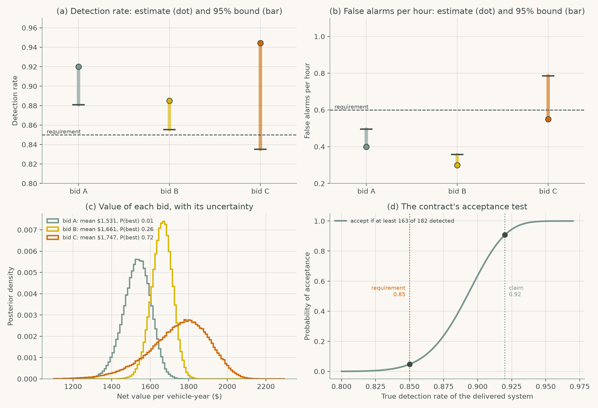
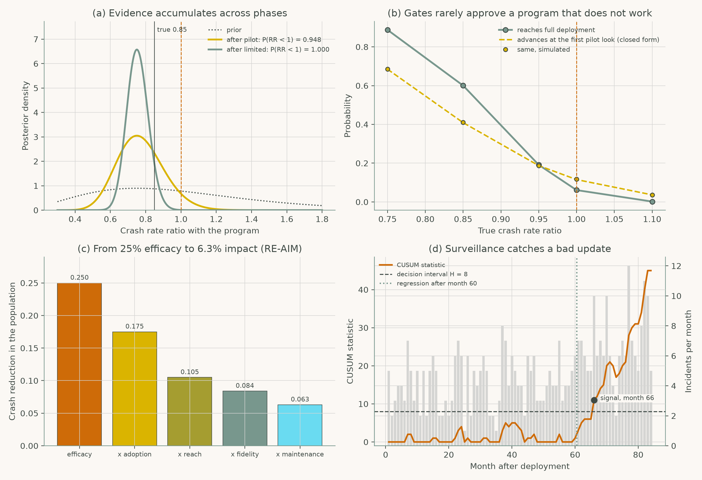

# Chapter 12: Policy, Standards, and Implementation

Companion code for Chapter 12 of *Human-Computer Interaction in Roadway Safety*. Each script is the concatenation, in book order, of that case study's listings in the chapter, so it runs top to bottom without edits.

| Script | Case study | Libraries |
|---|---|---|
| [`cs1_procurement.py`](cs1_procurement.py) | Case Study 1: Using HCI Evidence in Procurement for Safety-Critical Interfaces | NumPy, pandas, SciPy, matplotlib |
| [`cs2_implementation.py`](cs2_implementation.py) | Case Study 2: Implementation Framework for Agency and Industry Deployment | NumPy, pandas, SciPy, matplotlib |

## Case Study 1: Using HCI Evidence in Procurement for Safety-Critical Interfaces

Check three driver-monitoring bids against requirements using confidence bounds, compare their value under uncertainty, and design the contract's acceptance test.



## Case Study 2: Implementation Framework for Agency and Industry Deployment

Set Bayesian gates from pilot to full deployment, estimate population impact with RE-AIM, and detect a bad software update with CUSUM surveillance.



## Run

```bash
python scripts/run_all.py --chapter 12      # from the repository root
```

Outputs (figures, printed results) are written to `outputs/ch12/`.
